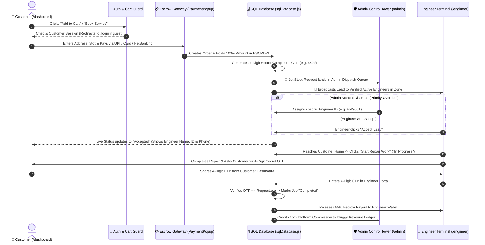
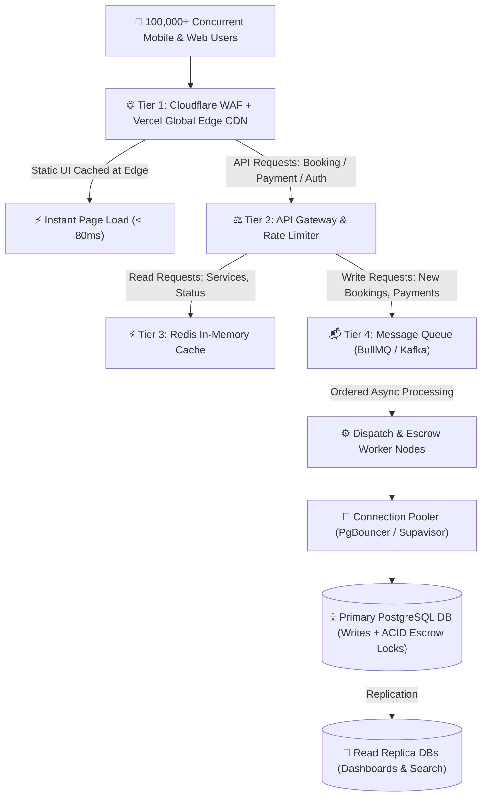

# ⚡ PLUGGY — Official System Architecture, Request Flow & Engineering Blueprint

> **Company:** Pluggy Home Services Pvt. Ltd.  
> **Founder & Code Owner:** Lakhan Kashyap (`@Lakhankashyap999`)  
> **Purpose of this Document:** This is the single source of truth for any Software Engineer, Backend Developer, DevOps Engineer, or Product Manager hired at Pluggy. It explains **how the system works end-to-end**, **who receives requests first**, **how code permissions are locked to the Founder**, and **how the architecture scales under massive traffic spikes**.

---

## 1. 🔒 Code Ownership & Permission Governance (Founder Lock)

No developer, freelancer, or agency can modify live production code (`main` branch / `pluggy-clean.vercel.app`) without the Founder's explicit approval.

### How Permission Lock Works:
1. **GitHub `CODEOWNERS` Lock ([`.github/CODEOWNERS`](.github/CODEOWNERS)):**
   - Every directory (`/src/lib/`, `/src/context/`, `/src/pages/`, `/src/components/`, `/database/`) is locked to `@Lakhankashyap999`.
   - When a newly hired developer writes code, they **cannot push to `main`**. They must create a separate branch (e.g., `feat/new-service-category`) and open a **Pull Request (PR)**.
2. **GitHub Branch Protection Rules (Settings -> Branches -> `main`):**
   - ✅ **Require a pull request before merging**
   - ✅ **Require approvals (Minimum: 1)**
   - ✅ **Require review from Code Owners (`@Lakhankashyap999`)**
   - ✅ **Do not allow bypassing the above settings**
3. **Vercel Preview URL before Production:**
   - Whenever a developer opens a Pull Request, Vercel automatically builds a **separate Preview Link** (e.g., `pluggy-clean-git-feat-xyz.vercel.app`).
   - The Founder tests that Preview Link on mobile & desktop first. Only when the Founder clicks **"Approve & Merge"** on GitHub does the change go live on the main website.

---

## 2. 🔄 End-to-End Request Lifecycle (A-to-Z Order & Dispatch Flow)

When a user raises a service request on Pluggy, here is the **exact step-by-step lifecycle** from booking to final payout:

### Step-by-Step Breakdown:
| Stage | Who Acts? | What Happens in the System? |
| :--- | :--- | :--- |
| **Step 1: Auth Guard** | Customer (`user`) | Guest users **cannot** add items to cart or pay. [`requireCustomerLogin`](src/context/AppContext.jsx) redirects unauthenticated visitors to [`/login`](src/pages/Login.jsx). |
| **Step 2: Escrow Payment** | Customer + Gateway | Customer pays via UPI (GPay, PhonePe, Paytm), Card, or NetBanking in [`PaymentPopup.jsx`](src/components/PaymentPopup.jsx). Money is held in **Pluggy Escrow** (`escrow_status = 'HELD_IN_ESCROW'`). A unique **4-Digit Secret OTP** is generated for the customer. |
| **Step 3: Kiske Paas Sabse Pehle Jayegi?** | **Admin Control Tower + Zone Broadcast** | As soon as the request is created in [`sqlDatabase.js`](src/lib/sqlDatabase.js), it immediately appears in **1) Admin Control Tower (`/admin` -> All Service Requests)** AND **2) Nearby Active Engineers' Job Feed (`/engineer`)**. Admin can manually assign/reassign any request to a specific Engineer ID (`ENG001`, `ENG002`, etc.), or an eligible Engineer in that zone can accept the broadcast. |
| **Step 4: Live Tracking** | Engineer -> Customer | Once assigned (`Accepted` -> `In Progress`), the Customer sees the Engineer's **Verified ID (`ENG001`)**, **Name**, **Phone Number**, and **Live Progress Bar** inside [`Dashboard.jsx`](src/pages/Dashboard.jsx). |
| **Step 5: 4-Digit OTP Lock & Escrow Split** | Customer + Engineer | Engineer **cannot** mark a job completed without the Customer's 4-digit OTP. When the Engineer enters the correct OTP in [`EngineerDashboard.jsx`](src/pages/EngineerDashboard.jsx), the SQL engine marks the job `Completed`, credits **85%** to the Engineer's Wallet, and records **15%** as Pluggy Platform Commission in [`AdminDashboard.jsx`](src/pages/AdminDashboard.jsx). |

---

## 3. 🚀 High-Traffic Scalability Architecture (Handling 10,000 to 10 Lakh+ Users)

When traffic spikes simultaneously (e.g., peak summer AC breakdowns, marketing campaigns, or city-wide expansion), here is how Pluggy handles heavy load without crashing or double-charging:

### 5 Pillars of High-Traffic Stability:
1. **Global Edge CDN (Zero UI Crash):**
   - All React UI bundles, images, and CSS are served from **Vercel Edge / Cloudflare CDN**. Even if 5 Lakh users open the homepage at the exact same second, the server does zero heavy lifting because static assets are served from the nearest city node (Mumbai, Delhi, Bengaluru).
2. **API Rate Limiting & DDoS Shield:**
   - Protects login and booking endpoints from bots or spam clicks (e.g., max 10 requests per IP per 10 seconds on `/login` and `/checkout`).
3. **Message Queue for Bookings (`BullMQ` / `Redis`):**
   - If 5,000 customers book an AC technician in the same minute, we don't hit the database with 5,000 heavy queries at once. Requests go into a **FIFO Queue**, immediately show the user `"Booking Confirmed — Assigning Engineer"`, and background workers match engineers smoothly within 1–2 seconds.
4. **Database Connection Pooling & Read Replicas:**
   - **Primary PostgreSQL DB** handles only critical **Writes** (New Orders, Escrow Payments, OTP Verification).
   - **Read Replicas + Redis Cache** handle 90% of traffic (Browsing services, checking order status, viewing engineer profiles).
5. **ACID Transactions & Idempotency Keys (Zero Double Payment):**
   - Every payment in [`PaymentPopup.jsx`](src/components/PaymentPopup.jsx) generates a unique transaction reference (`TXN...`). Using database row-level locking (`SELECT ... FOR UPDATE`), an engineer lead can never be accepted by two engineers at the same millisecond, and a customer can never be charged twice.

---

## 4. 🗂️ Codebase Structure & File Map (For Newly Hired Developers)

| File / Folder Path | Role & Responsibility |
| :--- | :--- |
| [`database/pluggy_schema.sql`](database/pluggy_schema.sql) | Production SQL DDL schema (`users`, `engineers`, `service_requests`, `orders`, `payments`, `reviews`) + seed data. |
| [`src/lib/sqlDatabase.js`](src/lib/sqlDatabase.js) | Relational SQL Engine in JavaScript with ACID-style persistence, foreign-key syncing, OTP verification, and Admin CRUD. |
| [`src/context/AppContext.jsx`](src/context/AppContext.jsx) | Central application state bridge connecting all 3 portals (`Customer`, `Engineer`, `Admin`) + Auth Guards (`requireCustomerLogin`). |
| [`src/pages/Login.jsx`](src/pages/Login.jsx) | Customer Split-Screen Login Portal (`/login`). |
| [`src/pages/Signup.jsx`](src/pages/Signup.jsx) | Customer Split-Screen Registration Portal (`/signup`). |
| [`src/pages/EngineerLogin.jsx`](src/pages/EngineerLogin.jsx) | Partner Engineer Login Portal (`/engineer-login`) — authenticates against Admin-created SQL engineer records. |
| [`src/pages/AdminLogin.jsx`](src/pages/AdminLogin.jsx) | Admin Control Tower Login Portal (`/admin-login`). |
| [`src/pages/Dashboard.jsx`](src/pages/Dashboard.jsx) | Customer Dashboard (`/dashboard`) — Live tracking, 4-Digit Secret OTP display, Payment Receipts, and Order History. |
| [`src/pages/EngineerDashboard.jsx`](src/pages/EngineerDashboard.jsx) | Isolated Engineer Portal (`/engineer`) — Shows **only** the logged-in engineer's jobs, OTP completion terminal, wallet, and ID card. |
| [`src/pages/AdminDashboard.jsx`](src/pages/AdminDashboard.jsx) | Isolated Admin Control Tower (`/admin`) — Full Engineer Roster management (Create new `ENGxxx` IDs, Edit details/passwords, Suspend/Delete), Manual Dispatch, and Escrow Ledger. |
| [`src/components/PaymentPopup.jsx`](src/components/PaymentPopup.jsx) | Multi-mode Escrow Payment Gateway (UPI with inline GPay/PhonePe/Paytm/AmazonPay SVGs, Card, NetBanking, Wallet). |

---

## 5. 🎨 Strict Design System Rules (Mandatory for All Developers)

- **Primary Navy:** `#1A2A49` / `#223a61` (Headers, Authority Cards, Portals)
- **Brand Action Orange:** `#F37021` / `#FF8C42` (Primary CTAs, Highlights, Badges)
- **Clean Slate Background:** `#F4F6F9` & Crisp White `#FFFFFF`
- **Strictly Prohibited:** No neon purple, cyber-blue, or jarring gradients.
- **Mobile-First Rule:** Every component must be tested on `375px` mobile view first; `/engineer` and `/admin` must remain completely isolated from the customer navbar/footer.
